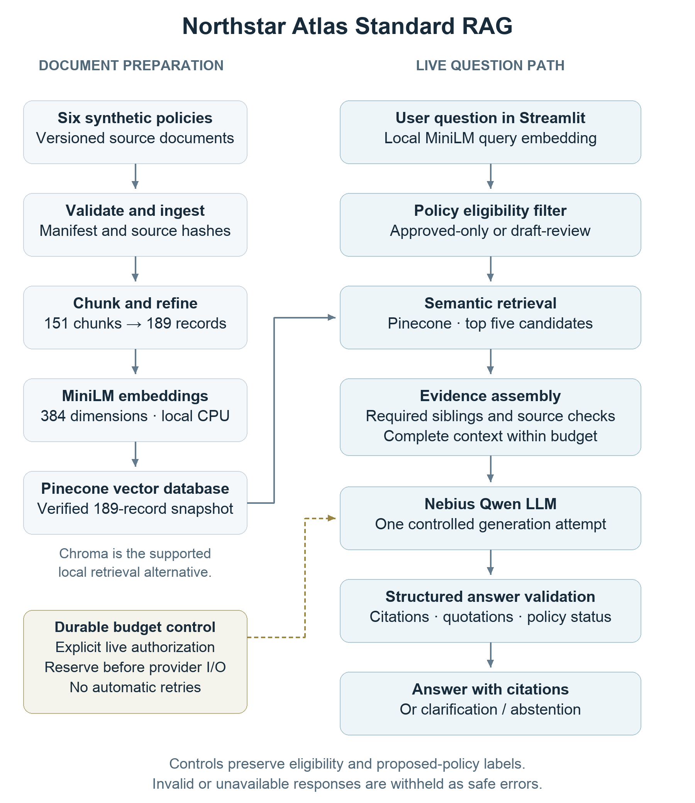
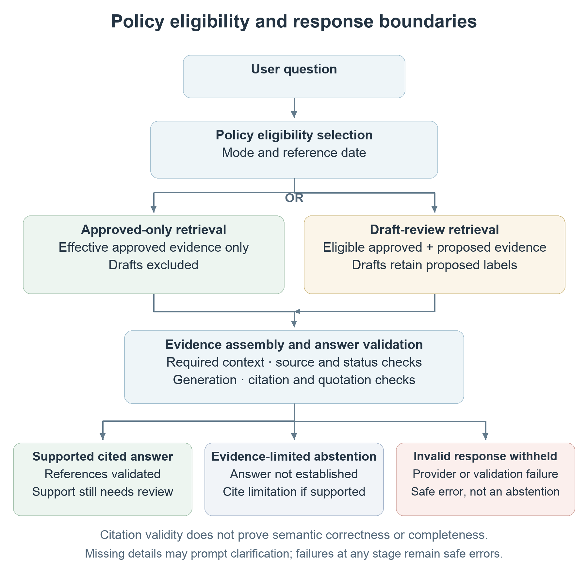
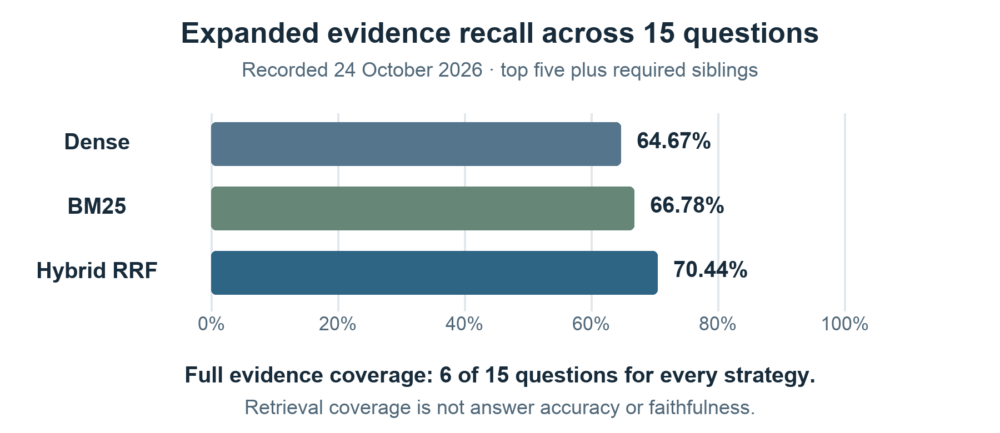

# Northstar Atlas

**Enterprise policy Q&A with traceable evidence and explicit policy authority.**

Northstar Atlas helps employees, managers and enterprise support teams find policy
answers across HR, IT Operations, Platform Engineering, SRE, Information Security
and Compliance. Users ask a question in a Streamlit chat interface, receive a
newly generated answer, clarification or evidence-limited abstention, and inspect
the supporting policy citations.

Policy responsibilities often cross departments: business approval, Security
authorization and technical provisioning may belong to different teams. Atlas
connects those sources while preserving conditions and approval status. It helps
people find guidance; it does not grant access, approve changes or execute actions.

Interactive **Standard RAG with Pinecone and Nebius has been demonstrated live**,
including accepted cited answers and an evidence-limited abstention. The optional
semantic LangGraph workflow is implemented and tested offline; successful complete
live execution has not been verified. All policies are synthetic.

## How it works



*The controlled Pinecone path is shown; Chroma remains the default local backend.*

The linear `QAService` defaults to dense retrieval and local Chroma; Pinecone is
explicitly selectable. BM25 and dense/BM25 Reciprocal Rank Fusion are optional.
Indexing is separate from answering questions.

The UI separates three experiences:

- **Offline demo:** clearly labeled authored examples; no retrieval or inference.
- **Policy search — retrieval only:** free-text search over real local Chroma
  evidence, with citations and relevance scores; no generated answer.
- **Live Q&A:** generated answers, Sources, and expandable Evidence and Validation
  details. Questions are independent; displayed chat history is not added to prompts.

Provider failures and rejected responses are withheld as safe errors, not presented
as policy abstentions. See the [public architecture guide](docs/README.md#current-component-boundaries)
for component contracts and engineering decisions.

## Technology stack

| Layer | Implementation |
| --- | --- |
| Runtime | Python 3.12, uv, pinned dependencies in `uv.lock` |
| Interface | Streamlit |
| Embeddings | Local CPU `sentence-transformers/all-MiniLM-L6-v2`; pinned revision, normalized 384-dimensional vectors |
| Retrieval | Chroma locally; optional managed Pinecone; standard-library BM25 and hybrid RRF |
| Generation | Nebius Token Factory, `Qwen/Qwen3-30B-A3B-Instruct-2507`, through an HTTPX adapter |
| Validation | Provider-independent `grounded-answer-v2` contract and deterministic evidence checks |
| Optional orchestration | LangGraph with bounded routing, retrieval, grading and semantic-checking profiles |
| Tests | Standard-library unittest, fake providers and opt-in cached-model integrations |

## Synthetic corpus and policy governance

The [corpus manifest](data/corpus_manifest.json) verifies six source documents in
[data/policies](data/policies/). Heading-aware processing produces 151 canonical
chunks; MiniLM-aware refinement produces **189 embedding-ready records**, retaining
source spans and sibling relationships. The recorded Pinecone publication verified
that 189-record snapshot. MiniLM's 256-token input limit is enforced without silent
truncation.

| Policy | Domain | Status |
| --- | --- | --- |
| HR-001 — Employee Role Change & Offboarding | Human Resources | v1.0, Approved (Synthetic), effective 2026-10-01 |
| IT-001 — Identity & Access Management | IT Operations | v0.1, Proposed |
| PLAT-001 — Production Deployment & Change Management | Platform Engineering | v0.1, Proposed |
| SRE-001 — Incident Response & Escalation | SRE | v0.1, Proposed |
| SEC-001 — Privileged Access & MFA | Information Security | v0.1, Proposed |
| COMP-001 — Access Review & Audit Evidence | Compliance | v0.1, Proposed |

**`approved_only`** admits approved policies effective on the reference date.
**`draft_review`** also admits proposed drafts, preserving their labels in evidence
and responses. A draft is not an effective company rule, even when an approved
policy refers to it.



Retrieved text is treated as untrusted evidence. Source hashes, citation identity,
version, status and required siblings are checked before generation. Context
assembly preserves complete evidence groups within the prompt budget. Citations
must refer to supplied eligible evidence; quotations must match contiguous source
text exactly or after whitespace normalization.

Caller-reviewed obligations can require specific evidence and statements; ordinary
questions retain coverage `not_assessed`. **Valid citations and quotations do not
prove semantic correctness or completeness.** A documented policy gap differs
from insufficient retrieval evidence.

## Quick start

Use an existing **Python 3.12** interpreter and [uv](https://docs.astral.sh/uv/getting-started/installation/).
The commands below are for macOS/Linux shells, run from the repository root.
Keep the environment and caches inside the checkout:

```bash
pwd -P
export NORTHSTAR_PROJECT_ROOT="$PWD"
mkdir -p .local/tmp
export UV_CACHE_DIR="$PWD/.local/uv-cache"
export UV_PYTHON_INSTALL_DIR="$PWD/.local/uv-python"
export UV_PYTHON_BIN_DIR="$PWD/.local/bin"
export UV_PROJECT_ENVIRONMENT="$PWD/.venv"
export TMPDIR="$PWD/.local/tmp"
export PYTHONPYCACHEPREFIX="$PWD/.local/pycache"
uv sync --locked --python 3.12 --no-python-downloads --extra ui --extra llm
```

This installs the local retrieval stack, UI and generation support. Add
`--extra pinecone` or `--extra orchestration` as needed; use `--all-extras` for
development. Model and index provisioning are separate. The application validates
its root, manifest and source hashes.

### Offline demonstration

```bash
export NORTHSTAR_UI_ENABLE_LIVE=0
export NORTHSTAR_UI_ENABLE_PINECONE=0
.venv/bin/python -B -m streamlit run src/northstar_atlas/ui/app.py
```

Open the local URL and select **Offline demo**. Its authored examples need no
provider configuration, cached MiniLM model or vector index. The local server
binds to loopback, with CORS/XSRF protections enabled and telemetry disabled.

### Local policy search

For real retrieval, validate the corpus, explicitly download the pinned model once,
and build the local Chroma index:

```bash
.venv/bin/python -B scripts/validate_evaluations.py
.venv/bin/python -B -m northstar_atlas.ingestion --mode draft_review
.venv/bin/python -B -m northstar_atlas.local_embeddings download
.venv/bin/python -B -m northstar_atlas.vector_store index
.venv/bin/python -B -m northstar_atlas.vector_store status
```

Skip downloading and indexing when verified assets are already ready. Runtime
embeddings use cached model files. Choose **Policy search — retrieval only** in
Streamlit to search up to five passages with citations and similarity scores.
Similarity measures retrieval relevance, not answer confidence.

## Configuration and controlled-live use

[`.env.example`](.env.example) documents supported settings and nonsecret defaults.
If using a local `.env`, create it only when absent and configure it privately;
never overwrite an existing file. Alternatively, supported values can come from
the process environment. Conflicting values are rejected. Reserved settings in the
example are not runtime overrides; MiniLM and the local storage layout remain fixed.

Live generation requires separately configured Nebius access, the reviewed model,
current pricing and explicit authorization. Server flags are process-environment
settings, not `.env` settings. The UI also requires session consent. Enabling a flag
alone is not sufficient for controlled hosted use.

### Optional Pinecone

Install the `pinecone` extra and supply the four required process variables when
`.env` is absent: `PINECONE_API_KEY`, `PINECONE_INDEX_NAME`, `PINECONE_CLOUD` and
`PINECONE_REGION`. All must be complete and valid. When `.env` exists, its security,
containment, Git-exclusion, parsing and environment/file conflict checks remain
mandatory; environment values cannot repair an incomplete file.

Both paths require an explicitly reviewed target, owner confirmation,
credential-fingerprint binding and compatible publication metadata. The adapter
verifies source/model identity and audits the remote index. It does not silently
select an account or provision resources. Pinecone still requires local MiniLM
for query embeddings. See the [retrieval and configuration guide](docs/README.md)
for the adapter and its verification boundaries.

### Controlled batches

The controlled interactive mode accepts user-entered questions through **Standard
RAG → Pinecone**, with either policy mode. Each separately approved batch permits
five submissions:

- Reserve the full bounded cost before provider I/O, with durable shared limits
  across sessions, processes and restarts.
- Reject duplicate invocation IDs and retain conservative reservations for uncertain
  outcomes; do not automatically retry failed requests.
- Display remaining capacity and disable submission when exhausted or unavailable.
- Settle accounting and durably record the accepted public result before display.

Private-preview verification, current pricing, operator approval and session
consent are required. Clearing chat or restarting does not renew the allowance.
The simpler local UI attempt counter is process-local and is **not** a durable
spending cap or an access-control system.

For an already provisioned and separately authorized controlled Replit preview,
run `bash scripts/run_replit_live.sh` using the [controlled-live launcher](scripts/run_replit_live.sh).
Its preflight checks must pass before Live Q&A is available. The default [.replit](.replit) launcher remains
offline-only. See [batch safeguards](docs/decisions/Interactive-Standard-RAG-Batch.md)
for the reviewed activation requirements; installation alone does not authorize
paid use.

## Recorded evaluation

The [frozen 15-question dataset](evaluations/README.md) covers precise HR lookups,
cross-policy scenarios, ambiguous questions and unsupported-value requests. The
24 October 2026 retrieval evaluation used the same source snapshot and an explicit
eligibility reference date.



| Strategy | Direct Recall@5 | Recall after sibling expansion | Full expanded evidence coverage |
| --- | ---: | ---: | ---: |
| Dense | 55.22% | 64.67% | 6/15 |
| BM25 | 51.56% | 66.78% | 6/15 |
| Hybrid RRF | 57.44% | 70.44% | 6/15 |

Hybrid recovered more required evidence on average, but did not improve complete
coverage and caused more full-prompt budget failures in this experiment. Dense
remains the default. Chroma and Pinecone returned identical top-five ID sets in
the recorded backend comparison, with two ordering differences.

These are **retrieval coverage scores, not answer accuracy or faithfulness**.
See the [retrieval and bounded-graph evaluation](docs/decisions/Retrieval-and-Bounded-Graph-Evaluation.md)
and [backend comparison](docs/decisions/M3.4-Chroma-Pinecone-Comparison.md) for
methodology, timing, missing evidence and failures.

Separate controlled live Standard RAG observations include accepted cited answers,
an evidence-limited abstention and a withheld HTTP 200 response-envelope validation
failure. Its exact cause remains unresolved; truncation is not confirmed. These
observations are not a live fifteen-question answer benchmark. Offline examples
and fake-provider graph tests are separate evidence.

## Optional LangGraph workflow

LangGraph is opt-in; Standard RAG remains the default. The profiles have different
behavior and call bounds:

| Profile | Behavior | Maximum LLM calls |
| --- | --- | ---: |
| `bounded_v1` | Deterministic routing and evidence assessment around retrieval and generation | 1 |
| `llm_routing_grading_v1` | LLM category routing and per-chunk relevance grading before generation | 4 |
| `llm_routing_grading_semantic_v1` | Adds semantic checking and one possible bounded regeneration | 7 |

The semantic workflow includes routing, retrieval, relevance grading, answer
generation and semantic checking. It supports Chroma and Pinecone, at most two
retrieval attempts and at most one regeneration after an unambiguous negative
semantic check. Deterministic validation always takes precedence; malformed,
unclear or exhausted checks withhold the candidate.

Conditional transitions and failure handling have been tested offline. Successful
complete live semantic-LangGraph execution has **not** been verified. Live use
requires separate authorization and reservation of the full workflow before
provider I/O. Future work is live end-to-end validation and comparison with
Standard RAG for answer quality, latency and cost. See the
[graph implementation](docs/decisions/M6.2-LangGraph-Implementation.md) and
[Pinecone graph integration](docs/decisions/Semantic-Graph-Pinecone.md).

## Tests

With all development extras installed:

```bash
export HF_HUB_OFFLINE=1
export TRANSFORMERS_OFFLINE=1
.venv/bin/python -B -m unittest discover -s tests -v
.venv/bin/python -B scripts/validate_evaluations.py
```

Tests use fake providers, not paid inference. Cached-model checks require the
pinned snapshot and `NORTHSTAR_RUN_MODEL_TESTS=1`; historical replays may skip when
local artifacts are absent.

## Limitations and next steps

- Six synthetic policies and fifteen development questions are a small, repeatedly
  inspected dataset. No held-out answer-quality or faithfulness score is established.
- Cross-policy evidence can be incomplete, including temporary AKS access ownership.
  Sibling expansion cannot recover source sections that were never retrieved.
- Valid source references can accompany unsupported free-form claims. Human review
  remains necessary for material policy decisions; semantic checking also depends
  on the evidence actually retrieved.
- Large evidence groups can exceed the complete prompt budget and block generation.
  The recorded provider-envelope failure and live semantic-graph validation remain open.
- Full-stack Linux installation, memory, startup and persistence need environment-
  specific verification. The locked Torch stack can pull substantial Linux wheels.
  The separate 35-package Replit UI-only setup supports authored previews, not live RAG.

Planned work includes independently reviewed held-out questions, human answer
assessment, better cross-policy candidate coverage, measured reranking experiments
and live graph comparison. Controlled demonstration does not establish readiness
for unrestricted production policy advice.

[Architecture and experiments](docs/README.md) · [Source](src/northstar_atlas/) ·
[Tests](tests/) · [Evaluation assets](evaluations/)

## Copyright and Permissions

Copyright © 2026 Anvesh Rao. All rights reserved.

This repository is made available for portfolio and evaluation purposes. No general license is granted to use, modify, redistribute, sublicense or commercially exploit the original project source code, except as permitted by applicable law or platform terms. Third-party components remain subject to their respective licenses.
