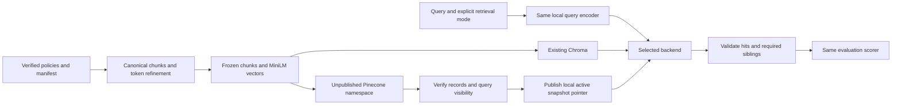

# Pinecone Managed Vector Search Design

> Historical engineering record. Proposals, scope limits and dated measurements
> describe the work at that time, not current setup or operational authorization.
> See the [current architecture and experiment guide](../README.md) and
> [project README](../../README.md) for the implemented system and remaining limits.

**Status:** Design approved for SDK/offline implementation; Azure selected.
**Date:** 2026-10-22. Cloud provisioning remains unapproved.

This design adds an optional managed dense-search backend while preserving the
existing corpus, MiniLM vector space, citations, authority filters, and evaluation
rules. SDK installation and an offline adapter were approved separately from
account access, credential use, upload and provisioning. Chroma remains the working
local backend.

## 1. Inspected Foundation and Reuse

| Existing component | Reuse and boundary |
| --- | --- |
| `embeddings.py` | `EmbeddingProvider`, `EmbeddingModel`, `EmbeddedChunk`, `embed_chunks`, `embed_query`, finite/dimension/nonzero/L2 validation; no Pinecone-specific embedding logic |
| `local_embeddings.py` | Cached CPU MiniLM; revision `1110a243fdf4706b3f48f1d95db1a4f5529b4d41`; 384 dimensions, L2 normalization, 256 tokens including special tokens |
| `ingestion/document_loader.py` and `chunker.py` | Manifest allowlist, source hashes, metadata validation, 151 canonical chunks; retain existing behavior |
| `ingestion/refiner.py` | `token-context-v1`, 189 embedding-ready records, exact spans, deterministic IDs, required siblings, protected PLAT-001 §6.1 conditions; reject unsafe inputs |
| `vector_store/records.py` | `IndexConfig`, deterministic JSON, `metadata_for`, `decode_chunk`, `context_ids`, `validate_context`; adapt transport fields around these contracts |
| `vector_store/pipeline.py` | `corpus_snapshot` and verified preparation logic; current index/search entry points instantiate Chroma directly and need a small backend-selection seam later |
| `vector_store/store.py` | Preserve `SearchHit` semantics and error-on-incomplete behavior; local filesystem locking and synchronous publication are not distributed transaction guarantees |
| `evaluation/retrieval.py` | Reuse `EvidenceCatalog`, `score_question`, `summarize`, and dataset validation unchanged; current runner explicitly opens Chroma, so Pinecone needs a separate backend runner |

Inspected `pyproject.toml`, parsed `uv.lock`, read the six-source manifest, all
15 questions, evaluation rules, M2.5 report, and final JSON run. At the original
M3.1 inspection Pinecone was absent from both the lockfile and installed distributions;
the subsequent [M3.2 offline task](M3.2-Pinecone-Offline-Adapter.md) records its installation.
Python is constrained to
`>=3.12,<3.13`; the existing environment is 3.12.15 on Intel macOS.

The local index sidecar still records 189 records and the M2.5 fingerprint:
`20f5ec1d95989e7c6f6b12579d089dea5be0fe815fd5ba357902d195d49dfac9`.
Its vector digest is
`996955ca563ba065886b0d97ca35d75604916742f4b2f41f9da94c87d1f76f77`.
This task reads saved state/results; it does not reopen Chroma or claim a new
live database integrity audit. Baseline application-code hashes still match.

## 2. Recommended Index and API

| Setting | Proposal |
| --- | --- |
| Index name | `northstar-atlas-dev`, subject to name availability in the approved project |
| Hosting | Managed serverless, on-demand capacity |
| Selected cloud/region | Microsoft Azure: `cloud="azure"`, `region="eastus2"` (East US 2, Virginia); Builder plan |
| Vector field | `embedding`, dense, dimension **384**, metric **cosine** |
| Embedding source | Existing local MiniLM; supply vectors for both documents and queries |
| API | SDK 10.x Documents API with one dense-vector field; one Pinecone document represents one existing chunk |
| Excluded features | No hosted embedding, semantic-text field, sparse vector, full-text schema, reranking, or Assistant |
| Deletion protection | Enable for the index; disabling/deleting requires explicit approval |
| Retrieval default | `approved_only`; `draft_review` must be explicit |

The current SDK uses `schema`/`deployment` for new indexes, with operations under
`index.documents`. Recommend that supported shape instead of mixing old
`ServerlessSpec`/vector-operation examples with a new schema index. This is still
bring-your-own-vector dense search; using the Documents API does not introduce
BM25 or server-side embedding. [SDK v10 migration](https://sdk.pinecone.io/python/migration/v10-migration.html)

The conceptual schema is one `embedding` field of type `dense_vector`, dimension
384, metric cosine. All other stored fields below are metadata, not additional
ranking signals. Search uses a dense-vector query on that field and explicitly
returns the required metadata/text fields, without returning vectors by default.
Index readiness checks inspect the actual vector field in the returned schema,
not only a name or a deprecated top-level dimension property.

Azure was selected by the project owner to align with their Azure engineering
experience and preferred cloud ecosystem. This changes placement, not the MiniLM
model, 384-dimensional cosine vector space, immutable namespaces, or evaluation.
On 2026-10-22, Pinecone's region/plan matrix lists `azure` / `eastus2` as generally
available on Builder, Standard, and Enterprise. Starter is unsuitable for this
Azure decision. Cloud/region are immutable after creation.
[Index configuration](https://docs.pinecone.io/guides/index-data/index-configuration)

This is Pinecone-managed serverless infrastructure, operated independently of our
Azure subscription. Selecting Azure does not deploy AKS, storage, or other resources
into our subscription, and does not use our Azure credentials. It is not Pinecone's
separate BYOC deployment option, which runs in a customer's cloud account.
[Managed serverless](https://sdk.pinecone.io/python/how-to/indexes/serverless.html),
[BYOC distinction](https://www.pinecone.io/product/bring-your-own-cloud/).

Public availability is verified; this account's Builder entitlement, capacity,
and target project are not. Recheck the exact region and account availability
immediately before separately approved provisioning. If `eastus2` is unavailable,
stop, report then-supported Azure alternatives and wait for the owner's selection;
never substitute AWS or another region automatically. The SDK guide also names
`germanywestcentral`, but the plan/availability matrix above currently lists only
`eastus2` for Azure: an SDK enum alone is not proof of Builder availability.

## 3. Record Metadata and Namespace Strategy

### 3.1 Lossless record mapping

Set Pinecone `_id` to the existing `chunk.chunk_id` without a backend prefix or
renumbering. Pass-through canonical chunks keep their original IDs; refined
fragments keep `refined:token-context-v1:<sha256>`. Namespaces scope records, so
the same ID can appear in two snapshots without changing citation identity.

| Fields | Representation and purpose |
| --- | --- |
| `embedding` | Validated 384-coordinate vector; same float32 values as the comparison snapshot |
| `text` | Exact rendered chunk text, including tracked context duplication |
| `document_id`, `title`, `department`, `version`, `status`, `section_id`, `source_path`, `content_hash`, `citation` | Existing scalar metadata, unchanged; source paths remain repository-relative |
| `effective_date`, `effective_ordinal` | Existing ISO date/ordinal; drafts use empty string and zero, never a fabricated effective date |
| `original_chunk_id`, `kind` | Canonical family identity and canonical/refined discriminator |
| `embedding_model`, `embedding_revision`, `embedding_dimension`, `embedding_normalization` | Exact vector-space provenance |
| `required_context_ids`, `source_spans`, `chunk_json` | Existing deterministic JSON strings; preserve parent headings, indexes, segment roles, and all dataclass metadata |
| `record_id` | Duplicate of `_id`, permitting exact-ID metadata-filtered visibility probes |
| `snapshot_id`, `corpus_fingerprint`, `config_digest`, `storage_schema_version` | Pinecone envelope identifying the published generation and wire format |

Keep metadata flat: strings and finite numbers, with structured values encoded
through the existing sorted-key compact JSON serializer. JSON strings can contain
`null`; do not send an actual null metadata value. Do not rely on a service to
preserve integer-versus-float representation: normalize known integral fields only
after validating finite whole values. Strip only the explicitly declared envelope
and vector/text fields before calling `decode_chunk`; unexpected fields or altered
core metadata fail validation. [Data model](https://docs.pinecone.io/guides/index-data/data-modeling)

Before upload, measure UTF-8 serialized records and request sizes. Current limits
include 40 KB filterable metadata per document, 512-character record IDs, and
1,000 documents/2 MB per upsert without integrated embedding. Propose sequential
batches of at most 50 records and 1 MB serialized payload, whichever comes first.
Oversized metadata fails preflight; do not truncate text, spans, or sibling IDs.
The 189 raw float32 vectors alone occupy **290,304 bytes (283.5 KiB)**; metadata,
IDs, JSON transport, and service storage add overhead.
[Operation limits](https://docs.pinecone.io/reference/api/database-limits/operation-limits)

### 3.2 One complete corpus per immutable namespace

Use `dev-<snapshot_sha256>` for a namespace. Compute the full digest from the
corpus fingerprint, complete `IndexConfig`, Pinecone storage-schema version,
logical chunk/text/metadata digest, and frozen vector digest. Do not include the
timestamp or credentials. Identical inputs identify the same namespace; retries
reuse it. Chunk IDs remain backend-independent even if the envelope changes.

Store all six policies together. Department namespaces would require query fan-out
for multi-document questions. Separate approved/draft namespaces would duplicate
records and complicate changes in approval status. Use metadata filters within
the selected corpus namespace instead. A namespace is a partition, not a substitute
for credential permissions or policy eligibility checks.

Keep publication state locally under `.local/pinecone/`: a run manifest per
snapshot plus an atomically replaced `active.json` pointer. Manifests include
expected IDs, source hashes, payload/vector digests, model/configuration, target
project/index/host/region, counts, acknowledgments, and validation outcomes.
Do not insert readiness-marker vectors into the searchable corpus.

This first design supports one writer from this project. A local lock does not
coordinate another Mac or a Replit instance. A future deployment must explicitly
select and validate the same immutable manifest; multi-writer publication requires
separate design. No automatic namespace alias or shared control service is needed
for this small experiment.

## 4. Indexing, Publication, Updates, and Recovery

1. **Prepare locally.** Validate all manifest/source hashes, prepare canonical
   chunks, refine with the actual tokenizer, reconstruct source spans, validate
   all families, and reject every unsafe/over-limit input before network writes.
   Freeze the full 189-record snapshot, not just the currently approved subset.
2. **Validate target.** After provisioning approval only, describe the exact index
   and verify host/project, serverless region, ready state, dense field, dimension,
   cosine metric, and absence of hosted embedding. A missing or incompatible index
   stops the operation; normal indexing/search must never create or replace one.
3. **Mark pending.** Acquire the local writer lock and persist an `uploading`
   manifest before sending requests. Keep the prior active pointer unchanged.
   An existing namespace without a matching owned manifest is a collision to
   investigate, not a namespace to clear automatically.
4. **Upsert deterministically.** Send bounded sequential batches with fixed IDs
   and payloads. Record acknowledgments; a timeout has an unknown write outcome.
   Resuming the same snapshot can safely resend identical records. Do not report
   all records indexed merely because a bulk call returned without raising.
5. **Verify before publication.** List every expected ID with pagination and
   reject extras/missing IDs. Fetch all records in bounded batches; verify text,
   metadata, normalized vector values, digests, and required sibling families.
   Verify count 189 for this snapshot. Counts alone are insufficient.
6. **Verify search visibility.** Wait for query-visible writes before marking
   ready. Pinecone documents namespace-scoped write/query LSN checks, but their
   availability on the selected Documents API/SDK response must be tested. Do
   not assume a Vectors API header example proves Documents API support. The
   concrete fallback is a filtered dense search for each expected `record_id`,
   using its own frozen vector, checking the returned ID and metadata. Recheck
   only pending IDs with bounded backoff; no fixed sleep is treated as proof.
   Propose a five-minute polling budget; in-flight SDK retries can add time.
7. **Publish.** Recheck local hashes/configuration, persist a `ready` manifest,
   then atomically replace the local active pointer. A reader pins that namespace
   for its whole request, including siblings. Any verification failure leaves the
   run incomplete and unqueryable through the application.

Pinecone is eventually consistent. A query LSN reaching the relevant write LSN
demonstrates visibility of that write, but does not prove later writes did not
alter it. Immutable generations, payload checks, and a single writer therefore
remain necessary. Self-vector visibility probes establish readiness, not retrieval
quality. [Data freshness](https://docs.pinecone.io/guides/index-data/check-data-freshness)

For an identical ready snapshot, verify it and skip re-upserting unchanged data.
For changed source hashes, model/configuration, or removed policies, create a new
complete generation. The active namespace then contains only the new expected ID
set, so old IDs cannot contaminate searches. Unchanged chunk IDs may be reused in
that new namespace; per-source hashes identify why other IDs changed.

Retain the previous completed generation temporarily for rollback. After explicit
cleanup approval, delete only named, owned inactive namespaces and verify their
removal; never use an unscoped `delete_all`. Failed staging namespaces also need
recorded cleanup. Propose at most current + previous + one pending generation;
stop creating more if cleanup is unresolved. Publication and cleanup are separate:
a cleanup failure is reported without invalidating the verified active corpus.

If a run is interrupted, resume its exact manifest and reconcile remote state.
Never promote an incomplete run or quietly serve an older corpus when current
source hashes differ. Rollback requires selecting the matching older corpus and
configuration explicitly. Missing local publication state blocks Pinecone use
until an explicit full verification adopts or rebuilds a known generation.

## 5. Query Contract, Authority, and Errors

Queries validate current corpus identity and the selected ready manifest, encode
through the existing provider, and request `top_k=5` for evaluation. Apply these
filters **before ranking**, alongside snapshot/configuration constraints:

- `approved_only`: status equals `Approved (Synthetic)` and
  `0 < effective_ordinal <= reference_date.toordinal()`.
- `draft_review`: status is either the exact approved or draft label. Preserve
  each policy's status in the returned citation; do not relabel drafts.

Pinecone supports the required equality, numeric comparison, membership, and
logical filter operators. Revalidate every returned record against the pinned
local representation; client checks supplement the server filter, not replace it.
[Metadata filters](https://docs.pinecone.io/guides/search/filter-by-metadata)

Adapt the cosine score to the existing `SearchHit`: preserve the raw similarity
and set distance to `1 - score`, after finite/range checks allowing only documented
floating-point tolerance. Sort by distance then chunk ID as Chroma does. Neither
score is answer confidence. Different approximate index implementations can still
produce different candidates or tie order; do not rerank to hide that difference.

Fetch only the declared required siblings from the **same pinned namespace**.
Verify their IDs, document/version/hash/path/section, model, status/date eligibility,
and exact payload. Deduplicate context by ID and order it by canonical/refinement
position. Missing, altered, or ineligible required siblings fail the request;
never drop a sibling, silently substitute local text, or label it as a ranked hit.
Startup/evaluation preflight and postflight perform a full namespace audit;
ordinary queries validate returned records instead of refetching every remote
vector. Document this latency difference from Chroma's current full-index check.

Use a synchronous REST client initially. Propose 10-second per-attempt HTTP
timeouts, sequential requests, and no application retry loop stacked around SDK
retries. SDK REST defaults already retry transient failures up to three times;
`RetryConfig` does not currently control data-plane REST retries. Test the pinned
version rather than promising a 10-second total deadline. A timed-out write is
reconciled using fixed IDs. [SDK retry behavior](https://sdk.pinecone.io/python/guides/retries.html)

| Failure | Proposed response |
| --- | --- |
| Invalid query/vector, metadata, dimension, model, source hash, or HTTP 400 | Fail before upload where possible; no alternate model or automatic correction |
| Missing credentials, 401/403, wrong project/host | Stop with a sanitized configuration/authorization error |
| 404 index or active namespace missing | Report unavailable; never provision from a search request |
| Transient 408/429/5xx or connection failure | Let the SDK's finite retry policy run; report exhaustion and incomplete upload state |
| Monthly quota/storage exhaustion | Stop after SDK failure; no continuing retry loop or plan upgrade |
| Count/payload/sibling mismatch or publication timeout | Retain incomplete state; preserve previous pointer; require reconciliation |

Logs contain operation, batch/count, elapsed time, attempt/error category, usage,
and a safe request identifier. Exclude API keys, authorization headers, full HTTP
dumps, vectors, and full policy/query text by default. A remote failure is distinct
from a valid zero-hit result. No automatic fallback to Chroma during evaluation.

## 6. SDK, Dependencies, and Credentials

Recommend **`pinecone==10.0.0` as the candidate exact pin**, using its documented
API `2026-07` surface. This is a verified published release, not a claim that a
floating latest version is safe. PyPI specifies Python >=3.10 and provides an
Intel macOS CPython 3.10+ stable-ABI wheel, compatible in tag terms with Python
3.12.15. Its download is 3,098,155 bytes, not its installed footprint.
[Published release and wheels](https://pypi.org/project/pinecone/10.0.0/)

Published runtime requirements are `httpx[http2]>=0.27,<1.0`,
`msgspec>=0.19,<0.22`, `orjson>=3.11,<4`, and `anyio>=4.0`.
The current lock contains httpx 0.28.1, orjson 3.13.0, and anyio 4.15.1, which
satisfy those direct bounds. Expected new packages include Pinecone, msgspec,
and the HTTP/2 dependencies h2/hpack/hyperframe, absent from the current lock.
No direct requirement changes the existing MiniLM pins.
[Release dependency metadata](https://pypi.org/pypi/pinecone/10.0.0/json)

The original M3.1 assessment was metadata-only; the subsequent M3.2 note records
successful resolution and offline runtime tests. The installation acceptance rule
is to resolve for Python 3.12.15/Intel
macOS with project-local uv caches, inspect the exact lock diff and wheel set,
and stop on conflicts or changes to protected MiniLM versions. Do not build a
missing native wheel or upgrade dependencies automatically. Current SDK wheels
include native gRPC code, although this design uses REST; avoid unnecessary extras,
LangChain wrappers, pandas, and a separate gRPC installation.
[SDK installation](https://sdk.pinecone.io/python/getting-started/installation.html)

Propose an optional `pinecone` project extra so the local Chroma workflow does
not require the SDK. Lazy-load its imports only for the selected remote backend.
Update pyproject/lock only in the approved implementation task. Linux/Replit would
need its own wheel/runtime validation and explicit selection of the approved
snapshot; cloud-hosted vectors do not remove the local query-model requirement.

Credentials must come from `PINECONE_API_KEY` in the current process environment
or the deployment's approved secret injection. Nonsecret target configuration
includes index name, verified host, region, and selected snapshot. Never place a
key in code, the manifest, shell history, a command argument, a URL, or logs; leave
SDK HTTP debug output disabled. Do not change global environment configuration.
Use the least privileges actually available on the chosen plan; namespace names
are not access-control grants. No credential was read, created, requested, or
used during M3.1, and no account was inspected.

## 7. Cost and Lifecycle

Public information was checked on 2026-10-22; actual account plan, billing,
remaining quotas, and promotional-credit eligibility are **unknown**. Do not
assume the advertised Standard trial or any credit applies to this account.

| Consideration | Starter | Builder |
| --- | --- | --- |
| Public price | Free | $20/month flat |
| Storage allowance per organization | 2 GB | 10 GB |
| Monthly read/write units per organization | 1M / 2M | 2M / 5M |
| Indexes per project / namespaces per index | 5 / 100 | 10 / 1,000 |
| Region | AWS us-east-1 | Supported paid-plan regions, including Azure eastus2 |
| Fit for this task | Incompatible with the selected Azure placement | Selected plan; account entitlement/billing still unverified |

Sources: [pricing](https://www.pinecone.io/pricing/),
[object limits](https://docs.pinecone.io/reference/api/database-limits/object-limits),
[monthly usage limits](https://docs.pinecone.io/reference/api/database-limits/rate-limits).
These are shared account allowances, not reservations for Northstar Atlas.

Usage meters include storage, reads, writes, and egress. Queries, sibling fetches,
ID listings, and verification consume read usage; upserts and cleanup consume
write usage. Current query metering has a 0.25-RU minimum for small namespaces;
15 searches alone therefore have a nominal 3.75-RU floor, excluding all other
operations. Fetches have a minimum charge and scale with record count. Builder
blocks usage beyond its allowance instead of billing overage; its fixed monthly
fee still applies. Standard has a $50 monthly minimum and usage charges beyond it.
[Cost model](https://docs.pinecone.io/guides/manage-cost/understanding-cost)

This small synthetic corpus appears comfortably below storage allowances, but
raw vector bytes are not a bill estimate. Measure actual serialized metadata,
service usage responses, and account-wide consumption before quoting cost. Avoid
unnecessary charges by reusing ready snapshots, bounding retries/probes, batching
siblings, limiting retained generations, and avoiding hosted inference, backups,
dedicated capacity, or paid upgrades unless separately approved. Reducing returned
fields reduces payload/egress; it does not necessarily reduce query RUs, which
depend on namespace size. Spending alerts are monitoring, not an assumed hard cap.

Deleting an index removes its hosted data and makes that target unavailable.
Keep deletion protection enabled and require a separate explicit teardown action.
Deletion does not cancel a paid plan or guarantee a zero invoice; review the
subscription, accrued usage, and any separately retained resources.
[Index management](https://docs.pinecone.io/guides/manage-data/manage-indexes)

Rebuild after approval from the verified source manifest, exact chunking/refinement
versions, cached model revision, and frozen embedding snapshot if retained.
Re-encoding sources is possible if the vector artifact is lost, but floating-point
differences across runtimes must be recorded: do not claim byte-identical vectors
without checking. A recreated index may have a different host; revalidate target
configuration and publication state. No policy lives only in Pinecone.

Chroma, policy loading, local embeddings, tests, and the saved M2.5 baseline remain
usable without a Pinecone account or network. Backend selection is explicit;
local use requires neither credentials nor an installed optional Pinecone SDK.

## 8. Fair Evaluation Against Chroma

Freeze the same six-policy manifest, exact chunk IDs/text/spans, approval metadata,
384-dimensional float32 vectors, model/revision/normalization, and query vectors.
For the first comparison, export and validate the existing Chroma vectors against
its saved digest after implementation approval; do not silently regenerate a
slightly different matrix for Pinecone or rewrite the Chroma baseline.

Use all 15 unchanged questions with their specified modes, `top_k=5`, and the
same reference date `2026-10-22`. Apply eligibility before ranking, then identical
required-sibling validation/assembly. Do not tune either backend on these questions
or feed expected answers/evidence labels to the retriever.

Retain M2.5 `complete-source-section-v1`: whole canonical section coverage,
document-qualified parent matching requiring all descendants, duplicates consuming
ranked slots, and separate direct versus expanded metrics. Expanded reciprocal
rank uses direct trigger prefixes, not fictitious sibling ranks. C/D cases measure
conditional/limitation evidence, not successful clarification or abstention.

| Frozen M2.5 baseline | Direct | Expanded |
| --- | ---: | ---: |
| Recall@5 | 55.22% | 64.67% |
| Hit@5 | 86.67% | 93.33% |
| Full Evidence Coverage@5 | 26.67% | 40.00% |
| MRR / expansion-trigger MRR | 0.6944 | 0.8667 |

These are conservative source-coverage proxies, not human-adjudicated semantic
Recall. Preserve that limitation in Pinecone reports. A backend migration is not
expected by itself to fix the missing HR/Security dependencies or GCP limitation
evidence identified in M2.5.

Record rank overlap, changed missing units, authority failures, context size,
distances/similarities, and per-category metrics. Expect differences from network
round trips, TLS/client reuse, region, server load, consistency lag, floating-point
handling, and approximate-index implementation. Equal cosine configuration does
not guarantee identical top-five candidates or better relevance.

Keep the existing one-pass latency observation (mean 0.408 s; first query 3.915 s)
as historical data. For a new latency comparison, run both backends under the same
declared warmup/order/repetition policy. Separate model loading, query encoding,
integrity checks, remote search, sibling fetch, and total request time; include
retry counts and usage. Chroma currently verifies every stored vector per search,
whereas the proposed remote path audits the full namespace at run boundaries.
Report that difference rather than calling the timings a pure database-speed test.
Do not retrofit new timing measurements into the old artifact.

Save future run manifests and results beneath `.local/evaluations/` with backend,
SDK/API version, cloud/region, snapshot ID, schema, hashes, request settings, and
scoring version. Keep the old result immutable. No answer generation or
faithfulness evaluation is implied by either retrieval run.

## 9. Alternatives and Operational Risks

| Choice | Tradeoff and decision |
| --- | --- |
| Chroma only | Lowest operational complexity and offline use; remains the default/fallback selected by the user |
| Immutable Pinecone namespaces | Recommended: complete-snapshot publication and recovery are clear; duplicates storage/writes during updates |
| In-place differential upsert/delete | Fewer writes for large corpora, but readers may see mixed versions; defer until a coordinated maintenance/publication design is justified |
| Old vector API with older SDK | Familiar examples, but introduces another API-version choice; prefer a single pinned current-schema integration |
| Pinecone-hosted embeddings | Changes vector provenance, privacy, cost, and input behavior; excluded from the comparable baseline |

Principal risks are approval-filter mistakes, missing siblings, stale publication
state, eventual consistency, SDK/API drift, transport failures, account-wide quota
exhaustion, and synthetic text leaving the workstation. Native-wheel availability
and dependency resolution were subsequently validated in M3.2; live service
behavior remains untested. Keep all remote actions opt-in.
This is a development design, not a high-availability or multi-tenant production
authorization system. Azure `eastus2` and Builder are selected; account entitlement,
capacity, budget, credentials, and provisioning authorization still require checks.

## 10. Proposed Implementation Plan and Approval Boundaries

Local stages 1–4 are separate from cloud stages 5–6, which require explicit
account and provisioning approval. All local work must
stay in the authorized root, preserve existing policies/dataset, retain the current
MiniLM pins, and use project-local caches/artifacts. No commits or pushes are part
of this plan without a later explicit instruction.

1. **Approve and verify the dependency.** Add the approved exact Pinecone pin as
   an optional extra in `pyproject.toml` using uv; review the resolved `uv.lock`
   diff before installation. Verify Intel macOS wheels, installed size, import,
   and unchanged MiniLM behavior. Stop for conflicts rather than upgrading pins.
2. **Create transport-neutral preparation and contracts.** Add a small
   `vector_store/contracts.py` for the shared `SearchHit`/store contract and
   `vector_store/preparation.py` for verified record preparation/frozen snapshots.
   Update existing imports with compatibility re-exports. Preserve Chroma CLI
   behavior and scorer semantics; do not restructure unrelated ingestion code.
3. **Implement the optional adapter and publication state.** Create
   `vector_store/pinecone_store.py` and `vector_store/pinecone_state.py`. Implement
   metadata conversion, schema checks, explicit namespaces, bounded batching,
   idempotent resume, visibility checks, active-pointer publication, and scoped
   cleanup. Provisioning is a separate explicit action; constructors/search do
   not create indexes, enable services, or upgrade plans.
4. **Test offline before any cloud use.** Create `tests/test_pinecone_store.py`
   and `tests/test_pinecone_state.py` with standard-library unittest and mocked
   SDK responses. Cover float/integer metadata round trips, exact IDs and spans,
   authority/date filters, no key access for Chroma, mismatched vector spaces,
   partial acknowledgments, timeout-after-success, interrupted publication,
   stale sources, delayed visibility, pagination, unexpected IDs, sibling failures,
   bounded retries, unknown namespace ownership, and cleanup failure.
5. **Separate account/provisioning approval.** Confirm the actual organization,
   project, plan/credits/remaining quotas, cloud/region, index name, budget, and
   permission to upload the synthetic chunk text/metadata/vectors and use an
   injected key. Only then provision the approved index and run a bounded smoke
   test in an owned staging namespace. Verify dense score conversion, payloads,
   visibility fallback/LSN support, and the pinned SDK's real error behavior.
6. **Publish and evaluate only the approved snapshot.** Index 189 records,
   repeat to verify no duplicate writes, test recovery and reopening, run both
   authority modes and sibling expansion, and preserve all original digests.
   Extend `evaluation/retrieval.py` through backend-specific runners while keeping
   pure scoring unchanged; add parity tests to `tests/test_retrieval_evaluation.py`.
   Run the complete suite, M1.8 validator, and the controlled 15-question comparison.
   Record cost, latency and results before proposing further integration.

These are implementation acceptance criteria, not a claim that cloud work has
started. Approval of local implementation must not be interpreted as permission to
create a paid account, use credentials, or upload data.

## 11. Validation and Remaining Decisions

Validation completed: root and destination resolve inside the authorized project;
this is the only new deliverable, and no existing design note was overwritten.
The M1.8 validator passed all 15 questions, category counts, source hashes,
manifest pin, evidence sections, modes, and behaviors without network access.
All 85 pre-existing project/Git files and all seven physical Chroma files match
their pre-edit hashes. Markdown fences, whitespace, section completeness, and
recorded provenance checks passed. Public sources are linked near their claims.
No executable code changed, so the model/test suite was not rerun for this
documentation-only task; M2.5's 148-test pass remains historical evidence.

Update: the owner selected Azure `eastus2` / Builder and authorized continuation
of the M3.2 SDK/offline adapter scope using the candidate pin above. No packages
or resources were installed/created as part of this M3.1 decision edit.
Remaining decisions: confirm account entitlement and region availability during
an authorized account check; approve budget, provisioning, credential use and
synthetic-data upload; authorize any later cleanup by exact target.
M3.2 records SDK resolution and actual installation footprint. Cloud permissions,
Documents API freshness-header support and real remote behavior must be verified
during separately approved cloud integration.

Cloud provisioning remains a separate approval boundary. Validation above
describes the original design review; the [offline adapter record](M3.2-Pinecone-Offline-Adapter.md)
contains subsequent SDK validation.
