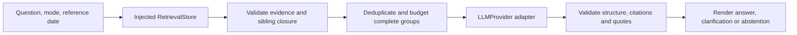

# LLM Provider Selection and Integration Design

> Historical engineering record. Proposals, scope limits and dated measurements
> describe the work at that time, not current setup or operational authorization.
> See the [current architecture and experiment guide](../README.md) and
> [project README](../../README.md) for the implemented system and remaining limits.

**Status:** Proposed; awaiting review. **Research date:** 2026-10-22 America/New_York / 2026-10-23 UTC.

**Recommendation:** Start with Nebius Token Factory serverless and the explicit model ID `Qwen/Qwen3-30B-A3B-Instruct-2507`. Keep Fireworks as an alternative. Keep Chroma as the default retriever and Pinecone optional. Introduce a small application-owned generation interface, evidence assembly, and citation validation; neither the LLM adapter nor its prompts should depend on a vector database SDK.

This is a design decision for the synthetic corpus, not an implementation or a claim of answer quality. No inference was purchased, actual credentials inspected, packages installed, models downloaded, or production indexes queried during M4.1. Tests used temporary local stores and fake cloud clients. Account access, model-specific structured-output behavior, and actual generation latency remain unverified.

## 1. Existing architecture and constraints

Inspected the loader, canonical chunker, token refiner, MiniLM adapter, Chroma/Pinecone stores, shared retrieval contracts, corpus manifest, evaluation dataset, M3.4 comparison, and dependency configuration.

| Existing component | Reuse in the answer pipeline |
| --- | --- |
| `vector_store/contracts.py`: `RetrievalStore.search` | Inject the selected backend. Pass the question, MiniLM provider, corpus fingerprint, mode, top-k, and an explicit reference date. |
| `SearchHit` | Supplies a ranked `PolicyChunk`, cosine distance, embedding provenance, and required sibling `context`. Similarity is not answer confidence. |
| `PolicyChunk` / `RefinedPolicyChunk` | Preserve document/section IDs, version, status, effective date, source hash, source spans, parent heading, and required context IDs. Refined text can contain explicitly duplicated, noncontiguous source segments. |
| Loader and store validation | Keep manifest/source checks, model compatibility, readiness checks, authority filtering, and sibling source-identity checks. Never generate from an incomplete or stale index. |
| M1.8 / M2.5 / M3.4 evaluation | Reuse questions, modes, evidence scoring and provenance. Expected answers, required evidence and forbidden inferences belong only to evaluation; never put the answer key into runtime prompts. |

The current snapshot has six policies, 151 canonical chunks and 189 embedding records. MiniLM remains `sentence-transformers/all-MiniLM-L6-v2`, revision `1110a243fdf4706b3f48f1d95db1a4f5529b4d41`, 384 dimensions, L2-normalized. Changing the generation model does not require re-embedding this corpus.

The [M3.4 baseline](M3.4-Chroma-Pinecone-Comparison.md) found identical top-five ID sets across both stores for all fifteen questions. Expanded recall was 64.67% and complete evidence coverage was 40.00%; among nine answerable questions, only five had complete expanded coverage. These are conservative section-coverage measures, not answer-faithfulness results. An LLM cannot be assumed to repair missing policy evidence.

Use normal production retrieval checks. M3.4's specialized evaluation adapters rely on prior verification receipts to avoid full audits; they are not an automatic replacement for the production retrieval path. Resolve one UTC reference date per request and pass it explicitly to either backend, avoiding their different default date sources.

## 2. Provider comparison

Only public documentation was consulted. Prices below are published USD rates per million tokens, not account quotes. Dynamic catalogue/pricing pages for Nebius returned no readable content through the research tool; its dated official developer guide provides the Qwen price observation. Recheck account access and current rates before an approved live run.

| Aspect | Nebius Token Factory | Fireworks |
| --- | --- | --- |
| API compatibility | OpenAI-compatible Chat Completions; base URL `https://api.tokenfactory.nebius.com/v1/`. [Quickstart](https://docs.tokenfactory.nebius.com/quickstart) | OpenAI-compatible Chat Completions; base URL `https://api.fireworks.ai/inference/v1`. [Text models](https://docs.fireworks.ai/guides/querying-text-models) |
| Initial model candidate | `Qwen/Qwen3-30B-A3B-Instruct-2507`: dated instruction release, non-thinking, text-focused. | `accounts/fireworks/models/glm-5p3-flash`: currently listed serverless chat alternative. Its larger/multimodal scope is unnecessary for this text-only corpus; quality must be compared empirically. |
| Context window | Official Nebius guide lists 262K; upstream Qwen specifies 262,144 native tokens. Confirm the hosted route's actual limit before use. | GLM page lists approximately 1M tokens (displayed as 1040k). Do not infer an exact enforced API ceiling from the rounded display. |
| Input / output pricing | Qwen: **$0.10 / $0.30**, observed by Nebius on October 15, 2026. Cached pricing not assumed. | GLM 5.3 Flash Standard: **$0.15 / $0.50**; cached input **$0.03**. Priority/region-specific routes have separate rates. |
| Structured output | Documents `json_schema` and `json_object`; support varies by model and must be checked on the selected card and smoke-tested. | Documents `json_schema`, `json_object`, and grammar modes. Use the portable schema subset and verify the selected model. |
| Python SDK choices | Official examples use the `openai` Python client; direct HTTPS also supported. No Nebius cloud-management SDK is needed for text generation. | Fireworks Python client, `openai` client, or direct HTTPS. A dedicated Fireworks SDK is optional. |
| Integration complexity | Small adapter for request/response mapping, authentication, budgets and errors. | Similar common API shape; schema details, usage fields and model options still need adapter tests. |
| Version pinning | Explicit dated ID is preferable to an alias, but does not establish an immutable hosted weights/runtime revision. | Pin the complete model path; a model path likewise is not proof of immutable serving configuration. |

Model/context/price sources: [Nebius developer guide, updated October 15](https://dev.nebius.com/cookbook/opencode-nebius-token-factory), [upstream Qwen model card](https://huggingface.co/Qwen/Qwen3-30B-A3B-Instruct-2507), [Fireworks GLM 5.3 Flash card](https://fireworks.ai/models/fireworks/glm-5p3-flash), and [Fireworks serverless pricing](https://docs.fireworks.ai/serverless/pricing). Schema sources: [Nebius structured output](https://docs.tokenfactory.nebius.com/ai-models-inference/json), [Fireworks structured output](https://docs.fireworks.ai/structured-responses/structured-response-formatting).

The same Qwen 30B Instruct model appears in Fireworks' catalogue, but its card explicitly says serverless is unsupported and offers on-demand deployment. Do not assume the dated model can be compared there at serverless token pricing, or create a deployment to make it available. [Fireworks Qwen card](https://fireworks.ai/models/fireworks/qwen3-30b-a3b-instruct-2507)

Other listed alternatives include newer Qwen models on Nebius and Nemotron 3.5 Lightning 30B A3B on Fireworks; the latter has Standard input/output rates of $0.05/$0.20. Lower token price alone does not establish citation accuracy, useful output cost, or simpler reasoning/token-budget behavior. The recommendation is a conservative starting hypothesis, not a benchmark win or a claim that Qwen is the cheapest available model. [Nebius Qwen family](https://nebius.com/services/token-factory/models/qwen-models-inference), [Fireworks pricing](https://docs.fireworks.ai/serverless/pricing)

### 2.1 Rate limits, usage controls and lifecycle

- **Nebius:** limits adapt to usage; actual base allocations are account-specific and visible in the console/response headers. The documentation's 60 RPM / 400,000 TPM table is an example, not our entitlement. Honor `Retry-After` for throttling. Billing documentation describes automatic card charging; a billing threshold is not a spending cap. A provider-enforced hard cap for this account was not verified. [Rate limits](https://docs.tokenfactory.nebius.com/ai-models-inference/rate-limits), [billing](https://docs.tokenfactory.nebius.com/other-capabilities/billing-new)
- **Fireworks:** adaptive prompt/output token limits and an account-wide request cap both apply. Monthly spend limits can pause self-serve usage; Enterprise alerts have different behavior. Actual account limits, credits and billing settings are unknown. [Serverless limits](https://docs.fireworks.ai/serverless/rate-limits), [account quotas](https://docs.fireworks.ai/guides/quotas_usage/account-quotas)
- **Both:** use application request/token budgets as well as any confirmed account controls. Do not change billing or enable automatic top-ups. Assume zero promotional credit in planning.
- **Deprecation:** a dated name does not ensure permanent availability. Nebius's August notice removed several older models, including Llama 3.3 70B, without automatic rerouting. Fail clearly if a selected model disappears; approve and evaluate a replacement before switching. [Deprecation notice](https://docs.tokenfactory.nebius.com/august-2026-deprecation-notice)

Why start with Nebius: the selected non-thinking instruction model fits concise evidence synthesis, offers a dated release identifier, and has modest published rates. Fireworks has useful documented spending controls and current serverless alternatives. Neither provider's accuracy, latency, account eligibility, or service guarantees have been tested here.

## 3. Minimal provider-independent interface

Proposed contracts, **not implemented**:

```python
class LLMProvider(Protocol):
    @property
    def model(self) -> LLMModel: ...

    def generate(self, request: GenerationRequest) -> GenerationResponse: ...
```

Use small immutable dataclasses and a structural `Protocol`, following the existing embedding interface. Keep embedding and generation contracts separate: the LLM produces language, not a vector in MiniLM's space.

| Value | Proposed contents |
| --- | --- |
| `LLMModel` | Provider, exact requested model ID, reported revision if available (`None` otherwise), supported response format, configured context/output limits and tokenizer identity. |
| `GenerationRequest` | System instructions, user question, rendered evidence packet, response schema, explicit maximum output tokens and sampling settings. No vector-store client, credentials or embedding arrays. |
| `GenerationResponse` | Untrusted output text, requested/reported model IDs, finish reason, input/output/cached/reasoning usage when supplied, request ID and latency. Unknown usage remains unknown, not zero. |
| Validated application result | `answer`, `clarify` or `abstain`; supported claims with validated evidence references; limitations; an optional clarifying question. Transport/validation failure is a separate error, not a policy abstention. |

The application service injects `RetrievalStore`, `EmbeddingProvider` and `LLMProvider`. Backend construction and credentials remain at the outer configuration boundary. A fake LLM provider supports offline tests. Provider adapters translate only the common request/response contract; they do not choose evidence, approve policies, render citations or bypass validation.



## 4. Evidence and context strategy

1. Validate nonempty question and supported mode. Default to `approved_only`, top-k 5; record an explicit UTC reference date and corpus fingerprint. Do not silently switch mode or backend on failure.
2. Use existing retrieval readiness/provenance checks. Approved-only requires approved status and an effective date no later than the reference date. Draft-review preserves each source's actual status. User acceptance of a project draft does not change policy metadata.
3. Collect direct hits and the complete transitive closure of required sibling IDs. Check eligibility and document/version/hash identity for every member. Missing required context is an error; do not present the remaining fragment as a complete rule.
4. Deduplicate by stable chunk ID. Conflicting payloads under one ID fail validation. Preserve direct rank separately from sibling provenance; siblings do not gain independent scores. Deduplicating text by sentence similarity is inappropriate because repeated conditions can qualify different rules.
5. Assemble deterministic evidence groups in direct-rank order, with members in source order. Preserve exact text and segment mappings, table headers, exceptions and parent-heading context. Initially retain explicitly marked duplicated context rather than reconstructing or paraphrasing source text for savings.
6. Budget entire connected sibling groups. If a group does not fit, exclude the whole group and record its IDs/reason. Never cut a table, sentence, approval condition or sibling off at the prompt boundary. If necessary evidence cannot fit, return a context-budget limitation or bounded abstention instead of an unsupported answer. Do not feed the model ground-truth evidence labels to decide what is necessary.
7. Assign request-local evidence aliases such as `E1`, mapped to immutable chunk IDs. Each supplied entry includes document ID/title, section and parent heading, version, status, effective date, source-relative path/hash, segment references and sibling relationships. Use repository-relative paths, never machine-specific absolute paths in hosted prompts.
8. Render evidence as escaped, explicitly delimited **untrusted source content**. System instructions define behavior; policy passages are data even when their text contains imperative language. Treat user instructions to ignore approval status or invent procedures as incompatible with the application contract.

### 4.1 Token budget

Proposed initial total application budget: **8,192 tokens**, including the complete prompt, a **1,024-token output reserve**, and **512 tokens of safety margin**. Thus counted prompt content must fit within 6,656 tokens. Use the smaller of this application cap and the verified hosted model limit. This intentionally stays far below advertised long-context capacities to limit cost and irrelevant material; it is a starting configuration to measure, not an evaluation-tuned optimum.

Count system instructions, schema, question, metadata, evidence and chat-template overhead using the selected **generation model's tokenizer**. MiniLM's 256-token limit and token counts cannot be reused for this purpose. Reject an over-budget question/instruction envelope before any paid call. Require truncation to be disabled; reject provider `length` finishes or incomplete JSON rather than returning partial policy advice.

Tokenizer-only files and their pinned revision will need a separately approved download under `.local/`. No Qwen tokenizer was downloaded in M4.1. Verify tokenizer/template behavior against the hosted route; if exact provider accounting is unavailable, record that limitation, use a validated conservative bound, and fail closed when budget compliance cannot be established. The safety margin is not proof of an accurate token count.

The upstream Qwen card requires newer Transformers for loading the full Qwen3 architecture; our pinned 4.48.3 must not be upgraded automatically. Hosted inference does not load Qwen weights locally. Demonstrate tokenizer-only compatibility with the installed libraries first; if it fails, report the conflict and propose a bounded alternative for approval. [Qwen loading requirements](https://huggingface.co/Qwen/Qwen3-30B-A3B-Instruct-2507)

## 5. Grounding, citations and answer behavior

Request a small JSON schema with `kind`, a list of `claims`, `limitations`, and an optional `clarifying_question`. Each policy claim must carry evidence aliases and short exact supporting excerpts. Do not ask for hidden reasoning, arbitrary URLs, or a model-generated confidence percentage. The renderer constructs prose from validated claim entries; it must not append an uncited free-form summary that escapes the same checks.

Validate locally before displaying:

- JSON shape, allowed keys/enums, field lengths, nonempty answers and allowed output kinds. Reject tool calls, incomplete finishes, malformed output and unsupported formats; never silently downgrade to unrestricted prose.
- Every citation alias must resolve to evidence actually included in this request after budgeting, with matching immutable identity and permitted status/date. A valid corpus section that was not supplied is not an acceptable citation.
- Supporting quotes must match exact supplied source spans. Refined chunks require their segment map; their bounding `source_start/end` alone does not describe all duplicated context. Do not strip qualifiers while normalizing quotes.
- Citation labels and links come from trusted metadata, for example `PLAT-001 v0.1 §6.1 (proposed)`. Resolve source paths within the repository and reject model-supplied file paths. Collapse duplicate display labels only while retaining all supporting chunk IDs internally.
- Attach status to each claim's evidence. Draft-derived claims must be visibly introduced as proposed, including when mixed with approved HR requirements. Conflicting or insufficient authority must remain unresolved rather than merged into an apparent approved rule.

**Citation validity is not semantic entailment.** A real reference and a matching quote can still support a misleading claim. The design requires conservative prompts, full conditions in context, and separate human-reviewed claim/qualifier evaluation. In particular, review who approves what, which deadlines apply, and the distinction between authorization and execution. Do not describe structural checks as a guarantee against hallucination.

Expected behaviors:

| Situation | Required behavior |
| --- | --- |
| Sufficient eligible evidence | Answer only supported policy claims and cite them; preserve conditions, exceptions and synthetic/draft labels. |
| Missing question attributes, with relevant conditional rules supplied | Ask a focused clarification, identifying the relevant branches without selecting one by assumption. |
| Unsupported procedure, missing authority, conflicting rules or insufficient evidence | Abstain from the unsupported conclusion and explain the evidence limitation. Do not infer that a policy does not exist merely because retrieval missed it. |
| No eligible evidence | Return a deterministic insufficient-evidence result without spending an LLM call. |
| Provider failure or invalid citations | Return a distinct sanitized error; do not fabricate a substitute answer or silently switch providers. |

PLAT-001 §6.1 is a required future regression case: technical Terraform review and Change Management's scope conditions must survive assembly and the answer. Exact source reconstruction alone does not prove this semantic completeness. The model must not invent production approval authority for HR, convert business days into hours, or fill missing procedures from pretraining.

## 6. Dependencies, configuration and security

Python is 3.12.15. Existing direct pins are Chroma 1.5.9, NumPy 1.26.4, Sentence Transformers 3.4.1, Torch 2.2.2 and Transformers 4.48.3; Pinecone 10.0.0 is optional. `httpx==0.28.1` and Pydantic 2.14.1 are already installed/locked transitively. Neither `openai` nor `fireworks-ai` is installed.

**Recommended initial transport:** a small synchronous Chat Completions adapter using existing HTTPX 0.28.1, with standard-library dataclasses/JSON validation for our small schema. If approved for implementation, declare HTTPX explicitly in an optional `llm` dependency group rather than relying on Chroma's transitive dependency. No new SDK package is necessary for this design. Exact schema wrapping and response parsing remain provider-specific and must be fixture-tested.

The shared `openai` Python SDK is an alternative that reduces manual transport parsing; the Fireworks SDK adds provider-specific convenience. Either introduces a new direct dependency and potentially new transitive packages. Resolve and report a compatible exact pin before requesting installation approval; no unverified latest version is prescribed here. LangChain, LangGraph and orchestration frameworks are unnecessary for this first straight-line pipeline.

Proposed settings, not edits to `.env.example` in this milestone:

| Setting | Proposed value / behavior |
| --- | --- |
| `LLM_PROVIDER` | `nebius`; explicit configuration, no automatic fallback |
| `LLM_MODEL` | `Qwen/Qwen3-30B-A3B-Instruct-2507` |
| `NEBIUS_API_KEY` / `FIREWORKS_API_KEY` | Read only the selected provider's key from process environment; never log or include in dataclass representations |
| `LLM_CONTEXT_TOKENS` / `LLM_MAX_OUTPUT_TOKENS` | 8192 / 1024, with 512-token margin |
| `LLM_TIMEOUT_SECONDS` | Proposed 30-second total deadline; small connect timeout |
| `LLM_MAX_ATTEMPTS` | Initially 1 for measured smoke calls; at most 2 only when retries are explicitly budgeted |
| `VECTOR_STORE` | Keep existing `chroma` default; `pinecone` remains explicit and optional |

Map provider names to approved HTTPS base URLs in configuration. Do not accept a request-supplied URL or forward credentials across redirects. Use explicit environment loading; do not source arbitrary `.env` shell code or change global settings. Account-specific keys must not be requested in chat. Keep project logs/artifacts under `.local/`, redact headers/errors, and omit raw prompts/responses by default. A future deliberately enabled evaluation artifact may retain only synthetic evidence and outputs with provenance.

For future retry handling, honor throttling delays within the total deadline and retry budget. Do not retry authentication, unsupported model/schema, invalid input or citation failures. A timed-out completion may already be billable; retrying it is not assumed idempotent. Provider refusal remains distinct from corpus-based abstention. No tools, shell execution, URL fetching, or policy-changing capability is exposed to the generation model. Prompt separation reduces injection risk; it is not a complete security guarantee.

Sending synthetic evidence to a hosted provider is still a separate data transfer requiring approval. Pinecone's Azure selection does not place the LLM in our Azure subscription. Nebius public endpoints have no fixed-region guarantee; private enterprise documents would require a separate data-handling/residency decision. [Nebius public endpoints](https://docs.tokenfactory.nebius.com/public-serverless)

## 7. Cost plan and reproducibility

At the observed Qwen rates, an illustrative request with 4,000 input and 600 output tokens costs:

`(4,000 × $0.10 + 600 × $0.30) / 1,000,000 = $0.00058`

Fifteen such requests would be **$0.00870** in model token usage. The same illustrative counts at Fireworks GLM Standard rates yield **$0.00090/request**, or **$0.01350/15 requests**. These are arithmetic examples, not measured usage or quality-equivalent model comparisons. Prices derive from the sources in §2; refresh them before a paid run. Exclude assumed caching, credits and discounts; retries, longer outputs/reasoning, taxes, funding minimums and optional Pinecone reads are not included.

For the first future smoke test, propose a maximum of **three sequential requests, one attempt each, and a $0.10 application estimate ceiling**, subject to explicit approval of the model/account and data transfer. Reserve the worst-case request budget before sending, record actual usage, and stop if pricing or usage is unknown/inconsistent. This local ceiling is not a provider billing guarantee and cannot limit other applications using the account. A later fifteen-question generation run requires its own approved scope. Do not provision dedicated capacity for this small experiment.

Record corpus/manifest hashes, retrieved and included chunk IDs, exclusion reasons, mode/date/top-k, embedding revision, backend snapshot, prompt/schema versions, tokenizer revision, requested/reported LLM ID, serving revision/fingerprint if supplied, sampling settings, token usage, finish reason, request ID and latency. Store unavailable hosted revision information as unknown. Freeze prompts and evidence for model comparisons; do not claim identical outputs from a model name or low temperature. Selecting a replacement LLM requires renewed answer evaluation, but leaves existing MiniLM indexes usable.

Without credentials or hosted service availability, local ingestion, Chroma search, offline evaluations and fake-provider tests continue to work. Retrieval inspection remains useful even when generation is disabled.

## 8. Proposed Implementation Stages and Approval Boundaries

| Task | Proposed work | Acceptance and approval boundary |
| --- | --- | --- |
| **Evidence assembly and generation contracts** | Add the small contracts, fake provider, deterministic context assembly/budgeting and citation validation. Keep retrieval behavior unchanged. | Approve this design first. Offline tests cover both modes, date eligibility, stale/missing siblings, deduplication, complete-group budget exclusion, unknown citations, exact source quotes, malformed output and prompt injection fixtures. Approve tokenizer-file download separately; stop on compatibility conflict. No paid calls. |
| **Hosted adapter and grounded generation** | Implement the approved HTTPX adapter and application pipeline; placeholder configuration only, then a bounded synthetic smoke run. | Obtain approval before dependency declarations/installation or paid calls. Verify selected account/model, structured-output support, hosted token accounting and cost controls. Test approved HR, proposed PLAT §6.1 conditions and unsupported evidence. No automatic deployment, provider fallback or upgrades. |
| **Answer evaluation** | Evaluate all fifteen questions with frozen evidence/provenance and the existing category expectations. | Separately approve paid scope. Report citation validity, claim faithfulness, qualifier preservation, authority leakage, clarification/abstention behavior, usage/cost and latency. Keep retrieval metrics separate from generation metrics; use human adjudication for semantic support. |

No UI, BM25, hybrid search, reranking, Pinecone changes or LangGraph is included. If missing evidence prevents acceptable answers, document the retrieval gap and propose a later scoped improvement instead of weakening answer requirements.

## 9. Open decisions and validation

Before live integration, confirm the provider/model selection, model availability and JSON-schema support for the intended account, compatible tokenizer revision/template, exact hosted token limit, data-processing acceptability and paid-run budget. The current account's credits, quotas, spending controls and billing status were not checked. Public documentation supports a recommendation, not authorization or proof of account access.

Validation completed in the existing Python 3.12.15 environment:

- **198 existing tests passed**, zero failures or skips, in **87.611 seconds**, including cached MiniLM integration checks. Cloud clients were fakes; no live Pinecone or LLM requests ran.
- **M1.8 validator passed:** fifteen unique questions, category counts 3/6/3/3, source hashes, manifest pin, evidence sections, retrieval modes and expected behaviors.
- SHA-256 comparison confirmed all **75 pre-existing files** in the captured source/test/data/evaluation/script/design/configuration and Git-index/HEAD snapshot were unchanged. This includes every policy, the corpus manifest, evaluation questions, `pyproject.toml` and `uv.lock`. Existing staged/untracked work was preserved.
- The only new deliverable outside ignored `.local/` is this design note. Validation logs and the unchanged-file snapshot are under `.local/m41/`. Local Markdown links resolve and fenced blocks are balanced.
- No dependency installation, paid/API-account operation, cloud resource change, commit or push occurred. Public documentation browsing was read-only. No M4.2–M4.4 implementation was started.

Reproduce the checks from the verified project root:

```bash
PYTHONDONTWRITEBYTECODE=1 TMPDIR="$PWD/.local/tmp" \
  HF_HUB_OFFLINE=1 TRANSFORMERS_OFFLINE=1 NORTHSTAR_RUN_MODEL_TESTS=1 \
  .venv/bin/python -B -m unittest discover -s tests
.venv/bin/python -B scripts/validate_evaluations.py
```

These checks verify the existing retrieval foundation and preservation of sources. They do not validate a hosted LLM, generated answer quality, or the proposed implementation. Dependency changes, downloads and paid inference require separate approval.
