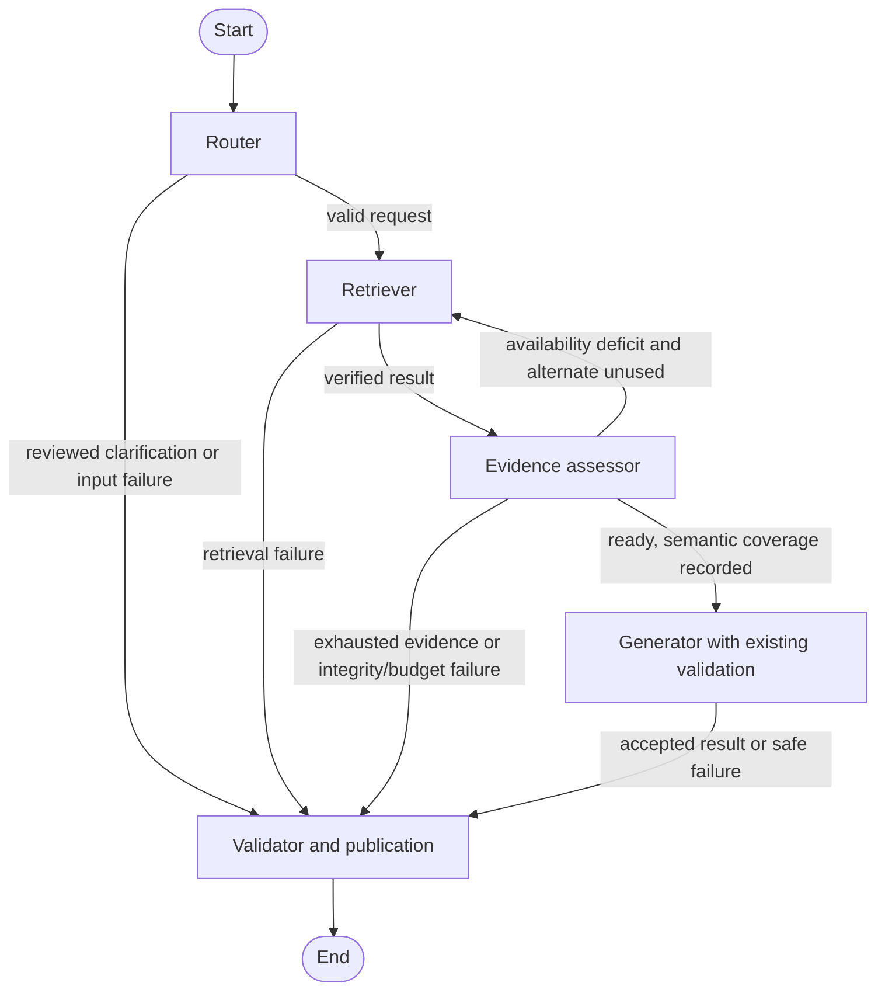

# Bounded Q&A Orchestration with LangGraph

**Date:** 2026-10-24.  
**Status:** Proposed design; implementation and dependency installation require approval.  
**Scope:** An optional in-process workflow around existing retrieval, evidence preparation and grounded generation. No graph implementation, installation, provider calls or deployment in this task.

This historical proposal preceded implementation. The SDK compatibility conflict
was resolved with SDK 0.4.9 while retaining WebSockets 17.3; see the
[implementation report](M6.2-LangGraph-Implementation.md) and
[final evaluation](Retrieval-and-Bounded-Graph-Evaluation.md) for the current results.

## 1. Recommendation and motivation

Add an optional `GraphQAService` with the existing `ask()` arguments and `QASuccess | QAFailure` output contract. Keep `QAService`, its default Chroma dense retrieval, the CLI and Streamlit behavior unchanged. Use five sequential nodes: router, retriever, evidence assessor, generator and validator. Permit at most two retrieval attempts and one LLM request per invocation. Do not add agents, tool calling, query rewriting, memory, checkpoint persistence, streaming or a model-based relevance grader.

LangGraph makes bounded transitions and their diagnostics explicit. It does not improve the retriever, certify semantic sufficiency, or replace validation. The [hybrid experiment](M5.2-Hybrid-Retrieval-Results.md) found expanded recall of 64.67% dense, 66.78% BM25 and 70.44% hybrid, but full coverage stayed at 6/15. Hybrid regressed on one cross-document question and did not recover the reviewed AKS provisioning sections. Full-prompt preparation succeeded for 14/15 dense and BM25 cases versus 13/15 hybrid. These findings rule out assuming that more retrieval or a high fusion score means enough evidence to answer.

Proposed graph trial configuration: Chroma, dense first, BM25 as the single alternate, five final direct hits per attempt. This is a recommendation, not an approved change to the application default. Hybrid remains selectable with its existing dense20 + BM2520, RRF60, final5 configuration. An alternate is used only for an observed availability deficit, not for every ordinary question.

### Alternatives

| Approach | Benefit | Cost or limitation |
| --- | --- | --- |
| Keep the current Python service only | Smallest runtime and no new dependencies; already safe and usable | No explicit graph experiment; adding branches directly would mix policy with orchestration |
| One graph node wrapping `QAService.ask()` | Minimal integration | Retrieval, preparation and inference are hidden inside one call; cannot perform the requested pre-generation assessment and alternate retrieval |
| **Five nodes reusing existing functions** | Visible bounded routing, same evidence/grounding contracts | Small shared-publication refactor and new orchestration tests; recommended |
| Split provider call and raw-response validation into separate new implementations | Superficially matches a five-stage pipeline | Risks duplicating or weakening proven validation and leaking raw candidates; unnecessary here |

The generator node will deliberately retain `generate_answer()`'s existing validation. The final validator node is the publication gate, not a second implementation of citation or quotation checks.

## 2. Existing architecture and reuse points

| Existing component | Reuse and boundary |
| --- | --- |
| [QAService and public models](../../src/northstar_atlas/qa.py) | Input conventions, explicit date/mode, safe errors, provider observation, immutable results and exact validated presentation fields |
| [Retrieval contracts](../../src/northstar_atlas/vector_store/contracts.py) | `RetrievalStore.search()` and `RetrievalHit = SearchHit | RankedHit`; preserve typed scores |
| [Chroma](../../src/northstar_atlas/vector_store/store.py) / [Pinecone](../../src/northstar_atlas/vector_store/pinecone_store.py) | Existing readiness, source/model checks, filtering and sibling fetches; no reindex/provisioning calls |
| [BM25](../../src/northstar_atlas/vector_store/bm25.py), [hybrid](../../src/northstar_atlas/vector_store/hybrid.py), [catalog](../../src/northstar_atlas/vector_store/catalog.py) | Existing frozen 189-chunk catalog, source reconstruction, eligibility and deterministic ranking |
| [Context builder](../../src/northstar_atlas/context.py) / [evidence models](../../src/northstar_atlas/evidence.py) | Complete sibling families, exact-span deduplication, source identity, status and evidence budget |
| [Generation](../../src/northstar_atlas/generation.py) | `prepare_answer()`, `generate_answer()`, `validate_answer()`, `render_answer()` and both v2 contract profiles |
| [Grounding](../../src/northstar_atlas/grounding.py) | Reviewed obligations, source-span bindings, cited abstention, exact/whitespace quotation matching; no weakening |
| [LLM contracts](../../src/northstar_atlas/llm.py) | Existing provider interface, usage and complete Qwen prompt bound; no LangChain model wrapper |

`QAService.ask()` currently retrieves, prepares, generates/validates, then renders and projects public fields. Its private `_accepted_presentation()` copies accepted statements and quotations without parsing rendered text. The proposed implementation extracts its existing rendering/public projection and safe provider-observation logic into shared internal helpers, with compatibility tests. It does not call `ask()` inside each graph node, repeat retrieval inside generation, or copy validators into graph code.

## 3. State schema and ownership

Use a `TypedDict` for the graph's internal update schema and existing frozen dataclasses for values. This is a design sketch, not an implemented module:

```text
GraphState
  request: FrozenRequest
    question: str
    mode: RetrievalMode
    reference_date: date
    backend: Literal["chroma", "pinecone", "custom"]
    strategy_plan: tuple[Literal["dense", "bm25", "hybrid"], ...]  # length 1..2
    top_k: int  # initially 1..5, default 5
    limits: GenerationLimits
    corpus_fingerprint: str
    model: str
    obligations: tuple[EvidenceObligation, ...]
    abstention: AbstentionRequirements | None
    extractive_scope: ReviewedExtractiveScope | None
    clarification: CallerReviewedClarification | None
  active_strategy: Literal["dense", "bm25", "hybrid"]
  attempt_count: int  # retrieval calls started: 0, 1 or 2
  retrieved_evidence: tuple[RetrievalHit, ...]
  assessment: EvidenceAssessment | None
  prepared: PreparedAnswer | None
  generation_result: ValidatedGeneration | None
  validation_result: PublicationValidation | None
  terminal_intent: Literal["clarify", "abstain"] | None
  failure: SafeFailure | None
  trace: tuple[AttemptTrace, ...]
  final: QASuccess | QAFailure | None
```

- `EvidenceAssessment` records `readiness` (`ready`, `insufficient`, `clarify`, `blocked`), `semantic_coverage` (`not_assessed`, `reviewed_inputs_bound`, `reviewed_inputs_missing`), reason codes, missing reviewed IDs and context warnings. `ready` means fit for the existing generation/validation path; it is not a statement of semantic completeness.
- `ValidatedGeneration` contains the accepted `GroundedAnswer`, safe usage/model/finish metadata and actual provider-call count. It excludes raw response text. `AnswerResult.response` is used transiently for diagnostics and is not copied into graph state.
- `PublicationValidation` records passed/failed/not-run, reason codes, quotation match kinds and the unchanged `ConditionCoverage`. No new probability or self-scored confidence field.
- `AttemptTrace` records strategy, counts, chunk/citation IDs, warning/reason codes and stage timings. It contains no prompts, raw responses, credentials or full policy text.

The service wrapper creates a fresh state for each request; callers cannot submit an arbitrary state dictionary, existing `final`, `attempt_count`, provider object or LangGraph runtime configuration. Question and policy text are untrusted data. Backend, strategy plan, reviewed requirements and optional clarification hints come only from trusted application configuration/callers, never from model output or document instructions.

The request is frozen after input validation. Policy mode, effective-date reference, corpus fingerprint, embedding identity, backend and required obligations stay fixed across attempts. Nodes return replacement values, never mutate hit objects, context packages or nested schema dictionaries in place. Retrying replaces the entire evidence/prepared/result state; it does not append stale hits. Trace accumulation is explicit tuple replacement, not an additive evidence reducer. LangGraph supports partial state updates with replacement behavior; use that simple model rather than message-history reducers. [Graph state documentation](https://docs.langchain.com/oss/python/langgraph/graph-api)

Adapters, MiniLM, provider handles, verified catalogs and a per-invocation call-budget guard live in injected execution context, outside serializable state. Only the retriever increments the retrieval counter immediately before invoking a store; only the observed provider increments the inference counter before a request. A failing call still consumes its allowance. State typing is not a security boundary: entry checks, node invariants and tests enforce ownership.

## 4. Node contracts

| Node | Inputs and operation | Output and routing |
| --- | --- | --- |
| Router | Validate existing question/mode/date/limits and trusted plan; pin one date; reject incompatible reviewed inputs and duplicate/unknown strategies. No model call. | Initial strategy and retrieval route; a reviewed clarification goes directly to publication; invalid configuration becomes a safe failure. |
| Retriever | Call the selected existing store once with unchanged question, mode, date and fingerprint. Reuse adapters and cached query embedding where already supported; BM25 needs no embedder. | Verified hits with existing siblings, updated attempt count/trace. Store exceptions are terminal `retrieval_failed`, never evidence insufficiency. |
| Evidence assessor | Reuse `build_context()` for eligible complete evidence, inspect warnings and reviewed source availability, then use `prepare_answer()` with all original reviewed requirements for complete prompt validation. | `ready` → generator; genuine availability deficit → one configured alternate or terminal abstention/error; integrity/budget issues → safe failure. |
| Generator | Invoke existing `generate_answer(prepared, observed_provider)` once. It already checks reviewed inputs, model identity, finish reason, structured schema, citations, quotations and obligations. | Only accepted answer data and safe usage survive. Provider failure → `provider_failed`; malformed/rejected/incomplete output → `response_rejected`. No repair, alternate generation or retry. |
| Validator / publication gate | Render through the existing guard and shared accepted-public projection; verify state/result identity and invariants. Validate application-authored terminal templates through existing validation where applicable. | The only node that creates `final`. Return existing success/error shape; never return the internal state or a rejected candidate. |

The assessor may call `build_context()` before `prepare_answer()` for classification. `prepare_answer()` currently builds context itself; allow this bounded duplicate **pure computation** initially and compare packages for equality. It avoids refactoring the trusted preparation contract. Do not repeat retrieval or provider IO to obtain it. Do not parse `GenerationError` message strings to decide whether a retry is safe.

For source integrity errors, missing/ineligible siblings, mixed hashes/models/status, source gaps, excluded evidence groups, or full-prompt overflow, stop with `context_failed` (or the existing retrieval error if detected earlier). This is not a reason to remove inconvenient evidence, lower the budget, choose a different authority mode or mask the problem with a policy abstention. Keep the 32,768 context / 1,024 output / 512 margin defaults for the first offline graph experiment; accept the same caller-specified limits as QAService. Streamlit's current explicit 2,048 output configuration is unchanged.

## 5. Evidence sufficiency and reviewed requirements

### Ordinary questions

No reviewed criteria are inferred from words such as Terraform, AKS or retention. With eligible context, intact siblings and a fitting complete prompt, proceed with `semantic_coverage = not_assessed`. Preserve ordinary result `coverage.status = not_assessed` even when citations validate. A nonempty but irrelevant result cannot reliably be identified by deterministic membership checks; it may still reach generation and require the existing clarify/abstain behavior or later human review.

An empty eligible result is an observable availability deficit. It permits one alternate retrieval, then a fixed insufficient-evidence abstention if still empty. Dense similarity, BM25, RRF, number of citations and source status are not semantic sufficiency thresholds. This design will not automatically discover the missing AKS provisioning facet for ordinary questions.

### Caller-reviewed requirements

Preserve `EvidenceObligation`, `AbstentionRequirements` and `ReviewedExtractiveScope` exactly. Validate their structure, IDs, scope/question/mode and source snapshot against verified local source/catalog data at setup or request preflight; no untrusted external IDs, stale hashes or fabricated quotes can trigger an alternate search. Reuse existing context/grounding functions to validate a temporary canonical package for the cited chunk IDs, solely to check the trusted configuration. That package must never be merged into retrieval evidence or used as an answer source. If the verified source/catalog needed for this preflight is unavailable, return configuration failure.

On each actual retrieval, a wholly absent required document/section or missing required chunk IDs is an availability deficit and can use the one alternate. A present source with conflicting hash/version/status, an invalid quotation/span, or an incompatible citation identity is a hard failure. After preparation, require exact `CitationReference` equality and all existing quotation/span bindings; do not regenerate citation IDs to make an obligation pass. Citation identity includes the actual chunk-ID set, so changed grouping can require a future caller review even when section labels match.

If every reviewed source binds, generation may attempt to answer; `reviewed_inputs_bound` still does not mean the answer is complete. Actual obligation-entry coverage is computed by existing validators after generation. If required sources remain absent after the allowed alternate, return a safe `context_failed` with missing IDs in developer diagnostics. Do not strip reviewed requirements to manufacture a generic accepted answer or evidence-backed abstention. This exception to the ordinary no-evidence abstention preserves the current grounding contract.

Do not use frozen evaluation `required_evidence`, expected answers or forbidden-inference lists as hidden runtime routing rules. Caller-reviewed requirements are explicit test inputs in a separate assessed track, not an automatic answer-key lookup.

## 6. Conditional edges and hard bounds



The trusted constructor takes a strategy plan of one or two distinct strategies. Recommended initial plan: `("dense", "bm25")`. Alternative experiments may explicitly configure `("bm25", "dense")`, `("dense", "hybrid")` or `("hybrid", "dense")`; no strategy is chosen by the model. Missing configured adapters or snapshots fail setup. A BM25-first plan must explicitly provision a local embedder before a dense alternate is available; no lazy model download is allowed.

Attempt two uses the same original question and replaces attempt one's evidence. Do not union attempts, cherry-pick favorable sections, compare incomparable scores, expand cross-document references, or fall back to the first answer. The alternate can be worse; retain both traces. No alternate retrieval after a provider failure, rejected answer, schema error or prompt-budget failure.

- Maximum store-level attempts: **2**; no third attempt or repeated strategy.
- Maximum inference requests: **1**; provider `max_attempts=1`, graph node retries disabled. A timeout is an unknown/failed outcome, never permission to resend.
- Hybrid still performs its existing two channels inside one store attempt; “two retrieval attempts” is not a promise of two network requests. Existing Pinecone readiness/fetch/transport behavior remains visible and must be metered when separately authorized.
- Fixed `recursion_limit=10` as a secondary guard, with no user override. The longest intended route executes seven nodes; test this against the selected LangGraph release. Counter/invariant failures and `GraphRecursionError` map to `internal_error`, never a partial answer. [Recursion configuration](https://docs.langchain.com/oss/python/langgraph/graph-api#recursion-limit)
- No checkpointer, interrupts/resume, background worker, fan-out, node cache, automatic replay or graph-to-graph recursion. Reinvocation is a new user submission and remains subject to Streamlit's existing duplicate/cost controls.

### Clarification and abstention

`CallerReviewedClarification` is an optional trusted question/mode-scoped hint containing an authored question and missing-detail labels, with no policy claims. It is incompatible with supplied obligation/abstention/extractive requirements in this first version; reject that combination rather than bypassing their binding. The router can select this hint without retrieval/inference. The validator validates an empty-claims v2 clarification against an empty context and publishes it through the normal render/public helper. Do not create a keyword-based ambiguity classifier. Without a hint, ambiguity can be surfaced by the existing model's validated `clarify` response after generation; it is not guaranteed to be recognized before retrieval.

For no eligible evidence and no reviewed requirements, publish the existing fixed `NO_EVIDENCE_TEXT` abstention with no citations/claims, basis `insufficient_evidence` and coverage `not_assessed`. Construct and validate the standard v2 terminal payload against the empty eligible package, then use the shared public projection; do not call an LLM to state that no evidence was found.

A **documented gap** requires caller-reviewed `AbstentionRequirements`, supplied limitation evidence and the existing cited/quoted v2 contract. Route this prepared request to the generator, then publish only if the existing checks pass. Failed retrieval, absent citations and source silence never establish that no policy exists elsewhere. Do not convert provider, infrastructure or context-integrity failures into policy abstentions.

## 7. Compatibility, resources and security

Propose `src/northstar_atlas/orchestration.py` and `tests/test_orchestration.py` only after approval, plus the small shared-helper refactor in `qa.py`. A separate `open_graph_qa_service()` factory exposes the experiment explicitly; `open_qa_service()` and direct imports continue to work without LangGraph installed. No Streamlit selector, CLI default, retrieval baseline or public result field must change for the first implementation.

The factory validates the authorized root and constructs the configured adapters once with `ExitStack`; reuse MiniLM, dense store and lexical catalog across sequential questions. Wrap the same dense adapter/catalog for hybrid rather than reopening another model/client. Validate all participating fingerprints/model revisions at setup and retain existing per-search stale-source checks. Do not create missing indexes or snapshots. For approved-only, every attempt and sibling must remain approved and effective on the pinned date; no draft fallback is possible. Backend selection is fixed: an alternate strategy does not silently switch Chroma/Pinecone accounts or targets.

Pinecone construction still requires its existing explicit account/namespace confirmation and may perform readiness/audit API requests; no such factory is opened during offline tests. Tests use fake adapters. Preserve immutable namespace validation and do not add repeated full audits per node. A future authorized graph experiment must report actual API usage, not infer it from the node counter.

The graph instance may be compiled once; invocation state and counters must never be shared between questions or sessions. Initial implementation supports sequential invocation, matching QAService; no concurrency guarantee. Close only factory-owned resources. Credentials stay in provider settings, never in state, metadata, graph logs or public errors.

Use local `StateGraph.invoke()` only. Do not initialize LangGraph SDK clients, LangSmith tracing, hosted services or checkpoint stores merely because their packages are installed transitively. Disable tracing in a scoped invocation context and pass no externally supplied callbacks; verify network silence with blocked sockets, including when tracing environment variables are set. Do not expose graph streaming/debug events to Streamlit. Return only `final`; sanitized transition diagnostics stay separate from public output.

The locked UI-only Replit preview must remain graph-free, with live providers disabled and no LangGraph import required from its entry point. LangGraph adds no model weights, but it does not solve Torch/Linux footprint or live deployment limits.

## 8. Dependency review and approval gate

**Candidate: `langgraph==1.2.16` as an optional `orchestration` extra.** Official release metadata lists Python >=3.10 and a platform-independent Python wheel; Python 3.12 is supported. This is a metadata-compatible candidate, **not a fully resolved or installed environment**. LangGraph and langchain-core are absent from this environment. [PyPI release metadata](https://pypi.org/pypi/langgraph/1.2.16/json)

Direct published requirements:

| Requirement | Current checkout / effect |
| --- | --- |
| `langchain-core>=1.4.7,<2` | New dependency; use only underlying graph plumbing, not model adapters |
| `langgraph-checkpoint>=4.3.0,<5` | New transitive package even with checkpointing disabled |
| `langgraph-prebuilt>=1.1.0,<1.2` | New transitive package; no prebuilt agents/tools used |
| `langgraph-sdk>=0.4.6,<0.5` | New transitive package; no hosted SDK client instantiated |
| `xxhash>=3.5.0` | New native package; target wheel availability must be checked |
| `pydantic>=2.7.4` | Existing 2.14.1 meets this requirement |

The release's [versioned source configuration](https://raw.githubusercontent.com/langchain-ai/langgraph/1.2.16/libs/langgraph/pyproject.toml) agrees with the metadata. Examining [core 1.4.7](https://pypi.org/pypi/langchain-core/1.4.7/json), [checkpoint 4.3.0](https://pypi.org/pypi/langgraph-checkpoint/4.3.0/json) and [SDK 0.4.8](https://raw.githubusercontent.com/langchain-ai/langgraph/sdk==0.4.8/libs/sdk-py/pyproject.toml) identifies additional dependencies including LangSmith, langchain-protocol, jsonpatch/jsonpointer, uuid-utils and ormsgpack (checkpoint requires >=1.12.0), plus LangSmith's eventual transitive dependencies. No full closure, binary-wheel download size or installed footprint was measured.

Existing HTTPX0.28.1, orjson3.13.0, Pydantic2.14.1, packaging26.3, PyYAML6.0.3, tenacity9.2.1 and typing-extensions4.16.0 meet the inspected core/SDK constraints. This is not proof that every future resolver-selected version will preserve them.

**Known lock conflict:** inspected SDK0.4.6/0.4.8 requires `websockets>=14,<17`, while `uv.lock` currently selects **17.3**. Installed Streamlit1.66.1 permits `>=12,<18`, so a 16.x version has an overlapping declared range. Nevertheless, changing the selected version is a real dependency change requiring approval and UI/proxy regressions. Do not silently downgrade it or claim the current lock can remain identical. The [reviewed Replit setup](../../scripts/setup_replit_offline.sh) validates the exact exported UI requirements hash; a changed WebSocket selection would require a separately reviewed subset/hash update, not removal of that guard.

Before installation, propose a constrained uv resolution that preserves all explicitly pinned application dependencies and reports every transitive change, macOS Intel/Python3.12 and Linux CPU wheel availability, plus the UI export diff. Keep caches/reports under `.local/`; do not install or update `uv.lock` in this design task. If approval requires retaining every current locked transitive version, this candidate cannot be accepted with the inspected SDKs: retain plain QAService and wait for a compatible release or a separately approved alternative. Do not bypass dependency metadata with `--no-deps`.

Use no `langchain` umbrella package, LangGraph CLI/server, LangGraph API service, SQLite/Postgres checkpointer, hosted tracing, additional provider SDK or model download. Package presence does not authorize network use. Total native-wheel compatibility and complete resolution remain installation preflight gates.

## 9. Offline evaluation and regression plan

Use standard-library unittest, deterministic fake stores/embedders/providers and blocked network sockets. Reuse existing source fixtures and public result assertions; fixture-supplied evidence is not a retrieval-quality result.

1. **Transitions and bounds:** normal router→retriever→assessor→generator→validator; empty first attempt then usable second; two empty attempts then abstain; one-strategy plan; at most two store calls and one inference attempt, including failures. Reject duplicate/unknown plans and attempts to inject counters/final state. Recursion-limit exhaustion withholds output.
2. **Evidence integrity:** missing sibling, ineligible sibling, conflicting payload, stale source hash/model/config and source gap fail terminally with no provider call. Do not use another strategy to hide corrupt evidence.
3. **Reviewed inputs:** missing required section may trigger the alternate; invalid/stale requirement fails preflight; exhausted missing requirements return context error. Retain exact citation identities; reject mismatched chunk sets/spans. No automatic obligation selection or caller requirement removal.
4. **Clarification/abstention:** reviewed clarification with zero calls; generated clarification validated; empty evidence abstention without citations; reviewed retention limitation with valid citations/quotes; missing/fabricated limitation citations rejected. Preserve documented-gap versus insufficient-evidence basis.
5. **Grounding:** HR approved answer, four application-owned Terraform obligations, legacy extractive and evidence-linked behavior, prompt injection fixtures, malformed JSON, `finish_reason=length`, model mismatch, duplicate/missing/unknown IDs, invalid quotation and rejected-answer nonpublication. Never retry a rejected result.
6. **Authority and state isolation:** every attempt uses the same mode/date/backend/fingerprint; draft-only results cannot be promoted in approved-only. Consecutive requests with different modes get fresh state, counters and evidence. Ordinary-query coverage remains `not_assessed`.
7. **Budget and errors:** complete context plus question/system/schema/output must fit; no sibling trimming or alternate for budget errors. Retrieval/timeout/configuration failures remain safe errors. Call accounting records failures; no raw exception text or rejected candidate enters returned result/trace.
8. **Compatibility and side effects:** direct QAService outputs and legacy rendered text unchanged; existing Streamlit projection/demo, credential opt-in and duplicate guards pass without importing graph packages. Pinecone fakes retain target checks. Network remains blocked even with tracing environment flags; no checkpoint, filesystem or remote writes beyond approved local test artifacts.

For the frozen 15 questions, first run graph-vs-linear compatibility with identical fake inputs, and then a separately approved local retrieval experiment with fake generation. Preserve dataset text/hash, modes, top-k5, date2026-10-22, corpus/model snapshot and complete-source-section-v1 scoring. Never label fake answers as measured LLM quality.

Keep two explicit tracks: **ordinary** (no reviewed criteria supplied; expected evidence used only after execution for scoring) and **caller-reviewed** (fixture requirements deliberately supplied; report this additional information). Never mix their headline results. Record first-attempt and final-attempt direct/expanded metrics, actually delivered context coverage, missing evidence, prompt readiness, attempt counts, provider-call counts and stage timings. Do not union evidence across attempts for a favorable metric. Preserve M2.5/M3.4/M5.2 artifacts; write new results under `.local/evaluations/m6/`.

Use the exact supplementary AKS question separately from the 15: “An engineer needs temporary production access to troubleshoot an AKS issue. Who should approve it, and which team grants the access?” Record that M5.2's dense/BM25 attempts miss reviewed provisioning references; the graph is allowed to expose the limitation, not invent the executor or certify completeness. Assess generic runtime behavior without leaking its rubric into routing. A separate caller-reviewed fixture can demonstrate abstaining/erroring when its reviewed evidence is absent.

Adoption requires no authority leaks or rejected-output publication, bounded calls, unchanged linear-service behavior and measured benefit that justifies extra latency. Do not switch defaults merely because graph transitions pass tests. Live Nebius/Pinecone tests, reranking, query rewriting, cross-document expansion and model-based assessment require separate authorization.

## 10. Proposed implementation sequence and current validation

1. Approve this design and decide the WebSocket/optional-extra resolution boundary. Review a complete dependency diff and platform wheels before installation; no permission to weaken the Replit hash guard is implied.
2. Extract and regression-test the existing accepted-public projection/provider observer without changing linear behavior.
3. Add the optional state types, five nodes, terminal templates, explicit edges and reusable factory. Keep graph imports out of existing application/demo import paths.
4. Add the offline transition/grounding/authority/compatibility tests above; run the full suite and M1.8 validator with no network.
5. Run only separately approved local graph comparisons; report failures and limits before proposing live validation or changing defaults.

Design-task validation:

- **242 existing relevant tests passed in 7.581 s**, with sockets blocked: QAService, context, generation/v2, grounding, abstention, application-owned extractive evidence, public presentation, BM25/hybrid/evaluation and Streamlit UI. There were no failures or skips. Streamlit emitted its expected bare-test `ScriptRunContext` warnings.
- M1.8 validator passed all 15 questions, category counts, source hashes, manifest pin, evidence references, modes and behaviors.
- All 14 repository-relative documentation links resolve. External dependency and API claims were checked against official public documentation/metadata; no inference or vector-provider endpoint was contacted.
- Before/after SHA-256 comparison found no changes to 121 pre-existing publication files and Git index, including all implementation files, policies, evaluation data, dependency pins and previous reports. The only new public file is this design. Local validation records remain under ignored `.local/m61/`.
- The full 491-test suite was not rerun for this document-only task; its prior M5.2 result remains historical. No new graph tests or runtime compatibility claims are possible until LangGraph is installed under separate approval. Dependency resolution, native wheels and graph execution remain unverified.
- A separate read-only builder review found no important unanswered planning questions. The dependency conflict and unmeasured runtime behavior remain explicit approval/validation gates, not resolved implementation results.

**Approval requested:** the optional five-node architecture, operational evidence assessor, explicit two-strategy bound and one-call generation limit; dependency resolution/installation scope must explicitly address the identified lock conflict. No implementation has begun.
